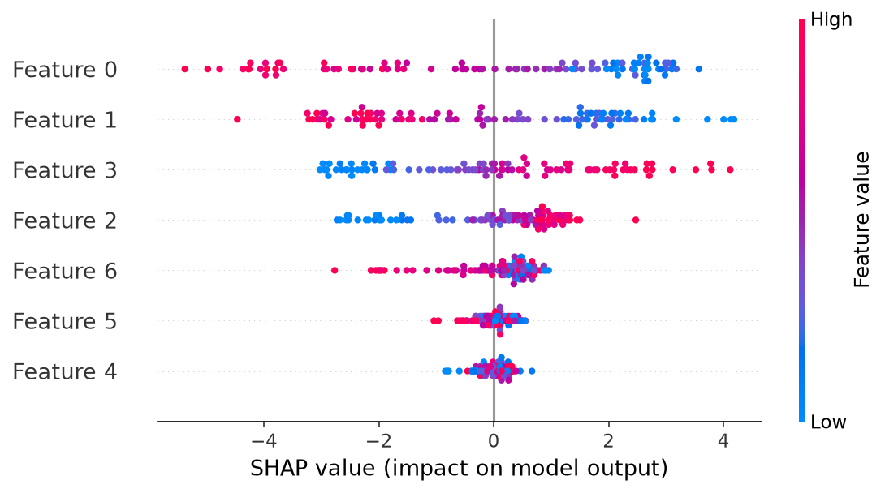

# 02_model_training.md

## Step 1: Выбор алгоритма

**Алгоритм:** `CatBoostRegressor` из библиотеки `catboost`.

**Rationale:**
- В отличие от `LinearRegression`, CatBoost нативно поддерживает нелинейные взаимосвязи между макроэкономическими признаками и PMI
- CatBoost устойчив к мультиколлинеарности (наши признаки `inflation` и `inflation_lag1` коррелируют)
- Встроенная поддержка SHAP-интерпретации через `get_feature_importance(type="ShapValues")`
- `allow_writing_files=False` — запрещаем модели писать файлы во время обучения (безопасность)

```python
from catboost import CatBoostRegressor

regressor = CatBoostRegressor(
    verbose=0,              # Скрываем логи обучения (100 итераций бесполезны для 120 строк)
    random_state=42,        # Фиксируем seed для воспроизводимости (Reproducibility)
    allow_writing_files=False  # Защита: модель не записывает файлы на диск
)
```

---

## Step 2: Feature Engineering — Взаимодействие признаков

**Проблема:** Линейные и древовидные модели плохо улавливают пороговые эффекты. Влияние инфляции на PMI зависит от ключевой ставки ЦБ — это не аддитивный эффект, а мультипликативный.

**Решение:** Кастомный трансформер `FeatureInteraction`, создающий признак `inflation × key_rate`.

```python
class FeatureInteraction(BaseEstimator, TransformerMixin):
    """Кастомный sklearn-трансформер для создания взаимодействия двух признаков."""
    def __init__(self, col1: str, col2: str, feature_columns: list = None):
        self.col1 = col1
        self.col2 = col2
        self.feature_columns = feature_columns or FEATURE_COLUMNS
        self.col1_idx_ = None
        self.col2_idx_ = None

    def fit(self, X, y=None):
        self.col1_idx_ = self.feature_columns.index(self.col1)
        self.col2_idx_ = self.feature_columns.index(self.col2)
        return self

    def transform(self, X):
        if isinstance(X, pd.DataFrame):
            interaction = X[self.col1] * X[self.col2]
            new_col_name = f"{self.col1}_x_{self.col2}"
            result = X.copy()
            result[new_col_name] = interaction
            return result
        else:
            # После RobustScaler X — это numpy array
            col1_vals = X[:, self.col1_idx_]
            col2_vals = X[:, self.col2_idx_]
            interaction = col1_vals * col2_vals
            new_col = interaction.reshape(-1, 1)
            return np.hstack([X, new_col])
```

**Rationale:**
- Наследуемся от `BaseEstimator` + `TransformerMixin` — это стандарт sklearn, гарантирующий совместимость с `Pipeline`
- Обрабатываем и `DataFrame`, и `numpy array` — после `RobustScaler` данные превращаются в numpy, поэтому нужна поддержка обоих форматов
- Индексы колонок фиксируются в `fit()`, а не ищутся по имени в `transform()` — это необходимо, потому что `RobustScaler` возвращает numpy array без имён колонок

---

## Step 3: Сборка Pipeline

**Проблема:** Если применить `RobustScaler` ко всему датасету перед split, статистики (медиана, IQR) будут "подсматривать" данные из test-сеты → **Data Leakage**.

**Решение:** `sklearn.pipeline.Pipeline` — скейлер обучается и применяется только на train-сете.

```python
from sklearn.pipeline import Pipeline
from sklearn.preprocessing import RobustScaler

pmis_pipeline = Pipeline([
    ('scaler', RobustScaler()),
    ('interaction', FeatureInteraction('inflation', 'key_rate', FEATURE_COLUMNS)),
    ('regressor', CatBoostRegressor(
        verbose=0,
        random_state=42,
        allow_writing_files=False
    ))
])
```

**Порядок шагов в Pipeline:**

```
Исходные данные (6 признаков)
     │
     ▼
┌─────────────┐
│ RobustScaler│  ← Масштабирование (устойчив к выбросам в oil_price)
└──────┬──────┘
       ▼
┌──────────────────────┐
│ FeatureInteraction   │  ← Создаёт 7-й признак: inflation × key_rate
└──────┬───────────────┘
       ▼
┌────────────────────┐
│ CatBoostRegressor  │  ← Финальное предсказание PMI
└────────────────────┘
     │
     ▼
   PMI prediction
```

**Почему `RobustScaler`, а не `StandardScaler`:**
- `StandardScaler` использует mean и std — чувствителен к выбросам
- `RobustScaler` использует median и IQR — устойчив к экстремальным значениям (например, скачок цены нефти)
- Макроданные часто имеют тяжёлые хвосты распределения

---

## Step 4: Разделение данных

**Стратегия:** Time-aware split (80/20), а не случайный `train_test_split`.

```python
split_idx = int(len(X) * 0.8)
X_train, X_test = X.iloc[:split_idx], X.iloc[split_idx:]
y_train, y_test = y.iloc[:split_idx], y.iloc[split_idx:]
```

**Rationale:**
- Данные временнóго ряда (按月 от 2016) — случайный split нарушит хронологию
- Модель обучается на прошлом (2016–2023) и тестируется на будущем (2024–2025)
- Это симулирует реальные условия: модель предсказывает будущее на основе прошлого

**Результат:**
- Train: 96 наблюдений
- Test: 24 наблюдения

---

## Step 5: Обучение и метрики

**Команда запуска:**
```powershell
.venv\Scripts\Activate.ps1
python src\backend\ml\train.py
```

**Результаты на test set:**

| Метрика | Значение | Интерпретация |
|---|---|---|
| **RMSE** | 2.8549 | Средняя ошибка в пунктах PMI. PMI измеряется в диапазоне ~35–65, поэтому ошибка 2.85 — это ~5–8% от размаха. |
| **MAE** | 2.3160 | Медианная ошибка. Меньше RMSE → нет крупных выбросов-ошибок. |
| **MAPE** | 4.95% | Средняя ошибка в процентах. < 10% — хороший результат для экономических данных. |

**Почему три метрики:**
- `RMSE` penalizes large errors сильнее (квадратичная функция)
- `MAE` даёт более стабильную оценку (линейная функция)
- `MAPE` удобен для не-технических стейкхолдеров (проценты)

---

## Step 6: Сохранение модели

**Метод:** `joblib.dump()` — сохраняет весь `Pipeline` целиком в один файл.

```python
import joblib

joblib.dump(pmis_pipeline, "model.pkl")
```

**Rationale:**
- Сохраняется не только модель, но и скейлер + трансформер взаимодействия
- Для инференса достаточно одного файла `model.pkl` — бэкенд загружает его и сразу делает предсказания
- `joblib` оптимизирован для numpy-структур (быстрее `pickle` в 10–100×)

**Результат:** `model.pkl` (1.1 MB)

---

## Step 7: Интерпретация — SHAP values

**Метод:** SHAP (SHapley Additive exPlanations) — теория игр для распределения "вклада" каждого признака в предсказание.

```python
def generate_shap_plot(pipeline, X_train, output_dir: str = "reports"):
    regressor = pipeline.named_steps['regressor']
    # Пропускаем X_train через трансформеры (scaler + interaction)
    X_transformed = pipeline[:-1].transform(X_train)

    explainer = shap.Explainer(regressor)
    shap_values = explainer(X_transformed)

    plot_path = os.path.join(output_dir, "shap_plot.png")
    shap.plots.beeswarm(shap_values, show=False)
    plt.savefig(plot_path, bbox_inches='tight', dpi=150)
    plt.close()
```

**Важный нюанс:** Перед вызовом `shap.Explainer` данные пропускаются через `pipeline[:-1].transform()` — иначе SHAP не найдёт признаки, которые модель видит (7 вместо 6).

**Результат:** `reports/shap_plot.png` — beeswarm plot, где:
- Каждая точка = одно наблюдение
- Ось X = SHAP value (влияние на предсказание)
- Цвет = значение признака (красный = высокое, синий = низкое)
- Порядок по Y = важность признака



---

## Итоговая структура артефактов

| Файл | Описание |
|---|---|
| `src/backend/ml/train.py` | Код обучения модели (189 строк) |
| `model.pkl` | Сохранённый Pipeline (1.1 MB) |
| `reports/shap_plot.png` | SHAP beeswarm plot (95 KB) |
| `reports/model_interpretation.md` | Подробная интерпретация метрик и графика |
